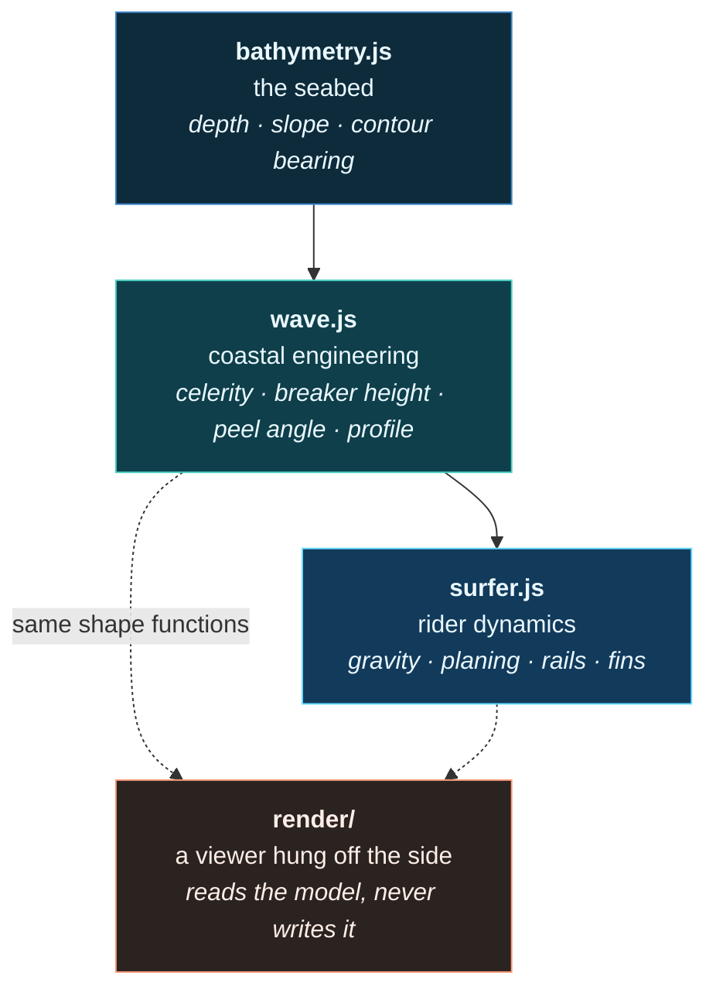

# Point Break

A low-poly, N64-flavoured right-hand point break surf simulator that runs in a browser.
The point of view is **from the wave, not from the beach** — you ride a mouth-mounted GoPro
down the line with the wall filling the left of the frame.

The wave is not animated, authored, or keyframed. It is **derived from a seabed** using
textbook coastal engineering, every frame, from the same functions the rider physics reads.
Change the depth over the reef and the wave gets bigger *and* faster, because in the ocean
those are the same fact.

> **Status: finished experiment.** This repo is a proof of concept about simulating a hard
> surface — surfing — in the browser, and it succeeded at that. It is not under active
> development. See [Project status](#project-status) before opening a PR against it.

---

## Quick start

```bash
npm install
npm run dev          # vite dev server
npm run build        # -> dist/
npm run preview      # serve the build
```

No API keys, no assets to fetch, no backend. The only runtime dependency is `three`.

Useful URL flags:

| flag | effect |
|---|---|
| `?debug=1` | live diagnostics overlay — fps, camera, NaN watch, buffer size, draw calls |
| `?touch=1` | force the touch controls on a desktop |
| `?touch=0` | force them off on a phone |

## Controls

| key | action |
|---|---|
| <kbd>←</kbd> <kbd>→</kbd> | turn down / up the face |
| <kbd>↑</kbd> <kbd>↓</kbd> | *hold* to walk your stance along the deck |
| <kbd>Space</kbd> | stamp the tail |
| <kbd>Space</kbd> ×2 | **snap** — break the tail loose in one explosive rotation |
| <kbd>↑</kbd><kbd>↑</kbd> | **pump** for speed; land them in rhythm to chain the multiplier |
| <kbd>↓</kbd><kbd>↓</kbd> *hold* | **brake** — bog the tail and stall a section |
| <kbd>C</kbd> | POV ⇄ chase camera |
| <kbd>R</kbd> | restart on the next seed |
| <kbd>Tab</kbd> | live tuning panel |
| <kbd>M</kbd> / <kbd>P</kbd> | mute / pause |

A tap and a hold are deliberately different gestures on the same keys — a tap fires a
manoeuvre and moves nothing, a hold walks your stance. On touch devices you get an analog
thumbstick plus sprite buttons instead.

**Speed comes from where you are, not from holding a key.** There is no accelerator. You gain
speed by dropping down the face, by sitting in the pocket where the wave is actually throwing,
by pumping in rhythm, and by banking hard enough that a turn converts the rising water into
thrust. You lose it to drag, to bad trim, and to riding out onto the dead shoulder.

---

## Documentation

| doc | what's in it |
|---|---|
| **[docs/architecture.md](docs/architecture.md)** | how the modules relate, the frame loop, the render pipeline, the coordinate systems |
| **[docs/wave-model.md](docs/wave-model.md)** | seabed → wave: the coastal engineering, the profile column, how a barrel happens |
| **[docs/rider-physics.md](docs/rider-physics.md)** | the force budget, the three manoeuvres, trim, scoring |
| [docs/references/PHYSICS-REPORT.md](docs/references/PHYSICS-REPORT.md) | a measured audit of the physics — verified behaviours, known simplifications |
| [docs/references/Surfing.pdf](docs/references/Surfing.pdf) | the source paper the planing model comes from |

---

## The idea in one diagram

Three layers, each consuming only the one below it. Nothing reaches back up.



The dashed lines are the important ones. `render/` is a **read-only consumer** of the
simulation, which is why 70% of this codebase has no idea WebGL exists:

| | lines | depends on `three` |
|---|---:|---|
| simulation, input, UI, audio | **3,413** | no |
| `render/` + `main.js` | 1,183 | yes |

## Everything is derived

The design rule the whole project is organised around: **no authored content anywhere.** There
is no list of wave sections, no scripted barrel, no difficulty curve. There is a seabed, and
everything else is a consequence of it.

```
depth      →  H = 0.78·d          how big the wave is
           →  c = √(g·d)          ...and how fast it moves
slope      →  ξ = slope/√(H/L₀)   Iribarren number → spilling or barrelling
contour    →  sin θ / c conserved Snell refraction → the peel angle
```

So a shallow steep ledge on the reef simply **is** a barrel section, and the `BARREL` label on
the HUD is read back off the numbers rather than written into a table. Drag the `SLOPE` slider
from 1:18 to 1:9 and fat sections become barrels with no other change.

The consequence worth knowing: **you cannot ask for a big slow wave.** A bigger wave breaks in
deeper water and therefore travels faster. Slow is bought with peel angle, not by slowing the
ocean down.

## Wave coordinates

Everything in the simulation lives in `(s, u)` and one derived quantity, `d`.

```
        s  ── distance along the crest line, increasing toward the shoulder
        u  ── height up the face: 0 at the trough, 1 at the lip tip
        b  ── the break point (the curl), which peels along s over time
        d  = s − b     ← the single number that drives the whole game

     d < 0        behind the curl, in the whitewater
     0 < d < 6    THE POCKET. steepest face, full power.
     d > 40       the shoulder. hasn't stood up. nothing to ride.
```

The face is **not a heightfield.** Each station has a cross-section built by integrating a
tangent angle `β(u) = φ·u^E` from the trough upward. When `φ` pushes past 90° the surface folds
back over itself and you get a real barrel — no special case, because the geometry is
parametric rather than `y = f(x, z)`.

## Repository layout

```
index.html              canvas, HUD markup, crash reporter, WebGL-loss handler
src/
  ├─ bathymetry.js      THE SEABED — the actual input to the simulation
  ├─ wave.js            the wave, derived from it. Profile column, crest line, world field.
  ├─ surfer.js          rider physics — a free body on the water
  ├─ config.js          every model constant, in one place, commented
  ├─ tuning.js          the live-tunable subset (localStorage-backed)
  ├─ tuner.js           the TAB panel that drags them
  ├─ input.js           keyboard, tap-vs-hold, double-tap gestures
  ├─ touch.js           analog thumbstick + sprite buttons for touch devices
  ├─ sprites.js         pixel-art control sprites, stored as grids not PNGs
  ├─ hud.js             speed, score, pocket meter, section callouts
  ├─ audio.js           three procedural noise beds, no asset files
  ├─ rng.js             seeded RNG + the maths helpers everything uses
  └─ render/            ← the only part that knows about three.js
       ├─ renderer.js   240p buffer + posterise/dither pass (the N64 trick)
       ├─ scene.js      sky, ocean, headland, beach, clouds, lights
       ├─ waveMesh.js   the wave as geometry, rebuilt every frame
       ├─ rider.js      ~120 triangles of board and surfer
       ├─ camera.js     mouth-mount POV and chase rig
       └─ spray.js      chunky point spray
docs/                   the documentation you are reading
```

---

## Project status

This is **step 1** of a larger study: get the hard part — a genuinely difficult physical
surface, simulated in a browser, tunable live — actually working. That part is done.

A port to WebGPU was explored and deliberately declined. The reasoning, so it isn't
re-litigated:

- **Not a performance problem.** ~16k triangles into a 560×240 buffer leaves the GPU idle. What
  frame time exists is JavaScript on the main thread, and a graphics API swap does not touch it.
- **The blocker was art direction, not the API.** `baseH: 240` plus a 26-step posterise and a
  4×4 Bayer dither annihilates every modern effect you would port *for* — bloom, SSR, depth of
  field, subsurface scattering. Retro and modern rendering here are mutually exclusive; you
  cannot bolt one onto the other.
- The value had already been captured, so the rewrite bought nothing this repo needed.

If you want the modern-rendering version, it starts as a new project that picks its renderer on
line one — and it inherits the 3,413 lines above that never cared what draws them.

## Licence

No licence declared. Personal experiment.
