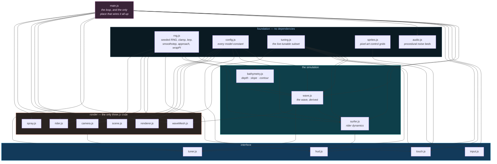
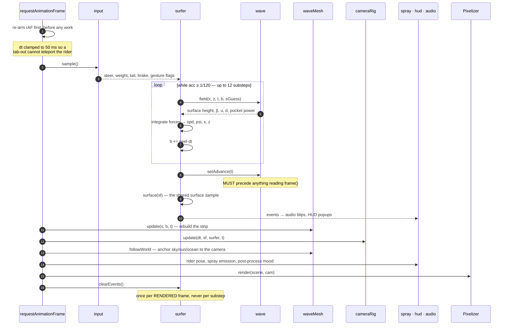
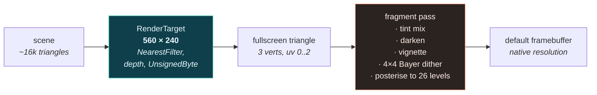
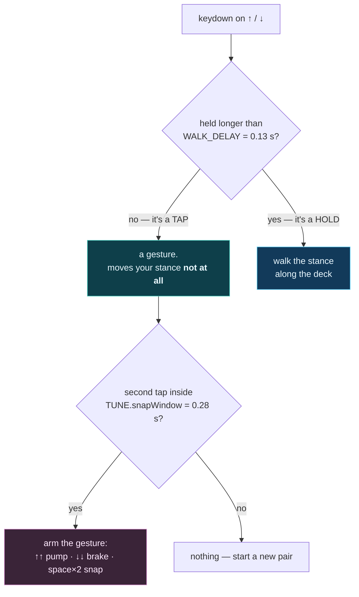

# Architecture

How the modules relate, what runs in what order every frame, and the coordinate systems
everything is expressed in.

- [Module graph](#module-graph)
- [The frame loop](#the-frame-loop)
- [Coordinate systems](#coordinate-systems)
- [The two motions of a wave](#the-two-motions-of-a-wave)
- [The render pipeline](#the-render-pipeline)
- [The wave mesh treadmill](#the-wave-mesh-treadmill)
- [Input: taps, holds and gestures](#input-taps-holds-and-gestures)
- [Configuration and live tuning](#configuration-and-live-tuning)
- [Ordering constraints](#ordering-constraints)

---

## Module graph

Every arrow is an actual `import`. The layering is strict downward — nothing in a lower layer
knows a higher one exists.



Three things this graph is designed to make true:

1. **`render/` reads the simulation; the simulation never reads `render/`.** The one apparent
   exception is `tuner.js → render/camera.js`, and it only imports two pure helpers
   (`POV_AIM`, `netLeadDeg`) so the panel can label a slider in real degrees rather than in
   raw gain.
2. **`waveMesh.js` calls the same shape functions the physics does** — `wave.shape()`,
   `column()`, `colAt()`, `colBeta()`. The wall you see is generated from the wall you ride,
   not from a parallel visual model. This is the single most important invariant in the repo.
3. **`main.js` is the only wiring.** Every other module is constructible in isolation, which
   is what made the headless physics probes in the [audit](references/PHYSICS-REPORT.md)
   possible.

---

## The frame loop

`main.js` runs a **fixed-step physics loop inside a variable-rate render loop**. Physics ticks
at 120 Hz so hard turns integrate stably; everything else runs once per displayed frame.



`acc` is capped at 0.1 s, so the substep loop can run at most 12 times — a long stall drops
simulation time rather than freezing the tab in a catch-up spiral.

### Why `clearEvents()` lives out here

The physics emits gameplay events (`PERFECT SNAP`, `CUTBACK`, `PITTED`) from inside substeps.
Clearing the queue inside `update()` meant only whatever the *last* substep happened to emit
survived to be seen — turn callouts were dropped about half the time, and a snap, which fires
on exactly one substep, was worse. The queue is now drained once per rendered frame.

The same reasoning drives `input.takeDouble(act)`: `sample()` returns `this`, and the substeps
all read that same object, so a plain boolean would fire a snap on every substep. Gesture flags
must be **consumed**, not read.

---

## Coordinate systems

There are three, and conversions between them are the bulk of `wave.js`.

### 1. World space

Plain metres, `y` up. The beach, the headland and the rocks are fixed here; everything else
moves through it.

### 2. Wave coordinates `(s, u)`

```
                                      ╱ lip  (u = 1)
                            apex ╱╱╱╱╱      ← where the face is vertical;
                              ╱╱╱             past this it overhangs
                            ╱╱
              face        ╱╱                  u = height up the face
           (0 < u < 1)  ╱╱                    s = distance along the crest
                      ╱╱                      b = the break point (curl)
    ~~~~~~~~~~~~~~~~╱╱                        d = s − b
    inside water   ▔▔  trough (u = 0)
      (u < 0)


    ◀── shoreward                        seaward ──▶


    s increases this way, toward the shoulder ───────────────▶

         d < 0          0 < d < 6           d > 40
      whitewater       THE POCKET         the shoulder
      behind the      steepest face,      hasn't stood
         curl          full power          up yet
```

### 3. The cross-section profile ("the column")

For a given station, `column(φ, A)` integrates a tangent angle from the trough up:

```
    β(u) = φ · u^E          E = CFG.wave.profE = 1.35
```

and produces two 33-entry tables, `run` and `ht`, walked by `colAt(u)`.

**`run` is measured seaward from the LIP, not from the trough**, so it is ≤ 0 on the face. This
anchoring is deliberate and was a bug fix: a real wave breaks along a nearly straight crest
line, and what varies down the line is the *steepness*, which moves the base of the wave
toward or away from that crest. A hollow section tucks its trough in under the lip; a fat
section slumps so the trough sits far out in front. Anchoring at the lip keeps the crest
straight and lets the trough travel. Anchoring at the trough did the reverse, and made the
whole wall appear to curve as you ran down the line.

Because the profile is **parametric** rather than a heightfield, `φ > 90°` folds the surface
back over itself and produces a real barrel with no special case anywhere in the code.

### Handedness

This is a **right-hander**: the lip sits to the rider's right as they travel. With the camera
looking down `+X`, the seaward normal must resolve to `+Z` (screen right), which is why
`Wave.frame()` returns `nx = −sin, nz = cos`. That sign choice flips the handedness of the
surface frame, so the outward normal is `cross(uface, t)` — **not** `cross(t, uface)`. Getting
it backwards lights the wave from inside and rolls the camera out of turns instead of into
them. Both `surfer.surface()` and `waveMesh.update()` carry a comment pointing at this.

---

## The two motions of a wave

A breaking wave does two independent things at once, and both are modelled:

```mermaid
flowchart LR
    subgraph A["1 · PEEL along the crest"]
        direction TB
        A1["b += peelAt&#40;b&#41; · dt"]
        A2["peel = c / tan&#40;α&#41;"]
        A3["the curl races down<br/>the line ahead of you"]
        A1 --> A2 --> A3
    end

    subgraph B["2 · DRIFT toward the beach"]
        direction TB
        B1["setAdvance&#40;t&#41;:<br/>_adv = driftSpeed · t"]
        B2["the whole crest line<br/>translates rigidly shoreward"]
        B3["the fixed beach and rocks<br/>visibly get closer"]
        B1 --> B2 --> B3
    end

    style A fill:#0e3f4a,stroke:#4ad0c0,color:#eaf8ff
    style B fill:#123a5a,stroke:#66d9ff,color:#eaf8ff
```



Only the peel existed at first, and the wall sat still in world space — the beach never
arrived. The drift is applied inside `Wave.frame()`, so everything that reads a frame inherits
it for free.

**The rider inherits the drift too, but conditionally.** `surfer.step()` adds
`wave.driftSpeed · dt · onFace` to its world position. That `onFace` factor is what *catching a
wave* means: you travel with it while you are on the face, and your own board speed only moves
you *around* on that face. Run over the back and `onFace` goes to 0, the wave lets go of you,
and it rolls on without you — you have genuinely lost it.

The face is therefore **a downhill that never runs out**, which is why `aWave` (the treadmill
glide term) exists rather than a one-off drop impulse.

---

## The render pipeline

The entire N64 look is one trick: render small, then blow it up through a posterise and dither
pass with nearest sampling.



`CFG.render.baseH = 240` fixes the internal height; the width is derived from the aspect ratio
and clamped to `maxW = 560`. So the fragment workload is ~134k pixels regardless of the display
— a 1080p frame is 15× that, and 4K is 62×.

The mood uniforms are driven per-frame from gameplay state: `uDark` drops to 0.42 inside a
barrel, `uTint` shifts to a green-blue in the tube and to white in foam, and `uVignette` closes
right down when you get pitted.

Two consequences worth stating plainly, because they shaped every later decision:

- **The GPU is idle.** 16k triangles into 0.13 megapixels is not a workload. Whatever frame time
  exists is JavaScript on the main thread — chiefly `waveMesh.update()`.
- **Modern post-processing is incompatible with this.** A 26-step posterise with an ordered
  dither destroys the subtle gradients that bloom, SSR and depth of field are made of. This is
  the reason the WebGPU port was declined; see [Project status](../README.md#project-status).

The vertex stage uses an oversized **triangle**, not a quad — three vertices with UVs running
`0..2`, clipped to the viewport. One primitive, no diagonal seam.

---

## The wave mesh treadmill

`waveMesh.js` keeps a **fixed grid** that always spans ~70 m behind the rider to ~230 m ahead,
and re-evaluates every vertex against the wave model at *absolute* stations each frame.

```
 columns:  26 behind (eased)  +  86 ahead (pow 1.5 — dense near you, coarse far away)  = 112
 rows:     5 inside-water rows  +  22 face rows (pow 0.88 — dense near the lip)        =  27
                                                                        ─────────────────
                                              3,024 vertices · 5,772 triangles per frame
```

Column spacing is `ahead · (i/n)^1.5`, so resolution concentrates where it is visible. Three
buffers are rewritten every frame — `position`, `color`, `normal` — plus a 5-row back skirt
draped from the apex so the crest reads solid against the sky, and 34 instanced icosahedra
churning as a foam ball at the curl.

Vertex colour does the work a texture normally would: depth gradient, backlit lip, whitewater at
the curl, a shadow cast by the overhanging apex, and a travelling sine that reads as water
racing up the face. `frustumCulled = false` and a 1e5 bounding sphere everywhere, because the
geometry is rewritten faster than a bounding volume could be maintained.

Normals are **analytic**, not computed from the triangles — the same `β(u)` that built the
profile gives the surface tangent directly, so there is no `computeVertexNormals()` pass over
3,000 vertices per frame.

---

## Input: taps, holds and gestures

On a keyboard, <kbd>↑</kbd> and <kbd>↓</kbd> carry two jobs: they are the stance-walk axis, and
they are the keys you double-tap for a pump or a brake. Splitting them **by duration** is what
keeps the two from contaminating each other.



`WALK_DELAY` is deliberately well under `snapWindow`, so both taps of a double are always short
enough to stay inert. Before this split, the taps of a gesture walked you a quarter of the way
down the deck *before the manoeuvre fired* — position coupling arriving through the input layer
rather than through the physics.

The brake needs a third mechanism: it is a **hold** that must outlive the double-tap that
started it, so `_brakeLatch` carries "still leaning on it" from the second tap through to the
release. It also suppresses the back-walk while held — otherwise "double-tap and hold to slow
down" would drag you to the tail the whole time, and you could never brake from mid-stance.

Touch folds in **last** in `sample()` and wins where it is live, so its analog axes survive
instead of being flattened to the `−1/0/+1` a key `Set` can express. Touch buttons call
`input.arm(act)` rather than reimplementing the gesture logic, so a snap from the on-screen
button and one from a keyboard double-tap are the same event downstream — the physics never
learns which device asked.

---

## Configuration and live tuning

Two layers, deliberately separated:

| | `CFG` (`config.js`) | `TUNE` (`tuning.js`) |
|---|---|---|
| what | every model constant | the subset worth dragging while playing |
| changed by | editing the file | the <kbd>Tab</kbd> panel |
| read | at construction and per-frame | **per-frame, always** |
| persisted | no | yes, `localStorage` |

Because `TUNE` is read inside `Wave.raw()` and `Surfer.step()` every frame, dragging a slider
changes the wall in front of you and the feel under your feet immediately — no rebuild, no
restart. The exception is anything marked `rebuild: true` in `tuner.js` (the seabed and swell
sliders): changing the wave's *length* rescales the whole section layout, so those restart the
ride on the same seed.

`waveSummary()` samples an actual `Wave` to populate the panel's derived readout, so the numbers
shown can never disagree with what you are riding. `COPY` puts a paste-ready block on the
clipboard; `COPY CAM` emits just the camera block.

---

## Ordering constraints

Four places where the sequence is load-bearing. Each one was a bug first.

1. **`wave.setAdvance(t)` before anything reads `frame()`.** The advance is applied inside
   `frame()`, so reading a frame before the crest has been marched gives you last frame's world
   position for this frame's geometry.

2. **`column(φ, A)` before `colAt` / `colBeta` / `colApexU` / `colTrough`.** These read
   module-scope scratch arrays. The pattern is: call `column()` once per station, then query as
   many rows as you like — and always re-call it before switching station. `Wave.field()` and
   `waveMesh.update()` both do this per column.

3. **`clearEvents()` once per rendered frame, not inside `update()`.** See
   [above](#why-clearevents-lives-out-here).

4. **`brakeLev` computed before `carry`.** `carry` now depends on it, and reading it any later
   would make it a substep stale.

One more, in the browser rather than the code: `index.html` installs its crash reporter as a
**plain inline script before the module**, so it is already listening if the module itself fails
to load or parse. A phone has no console — an uncaught error there presents as a black screen
and nothing else. The same handler listens for `webglcontextlost`, which throws nothing at all
and is the other way the page goes black.
