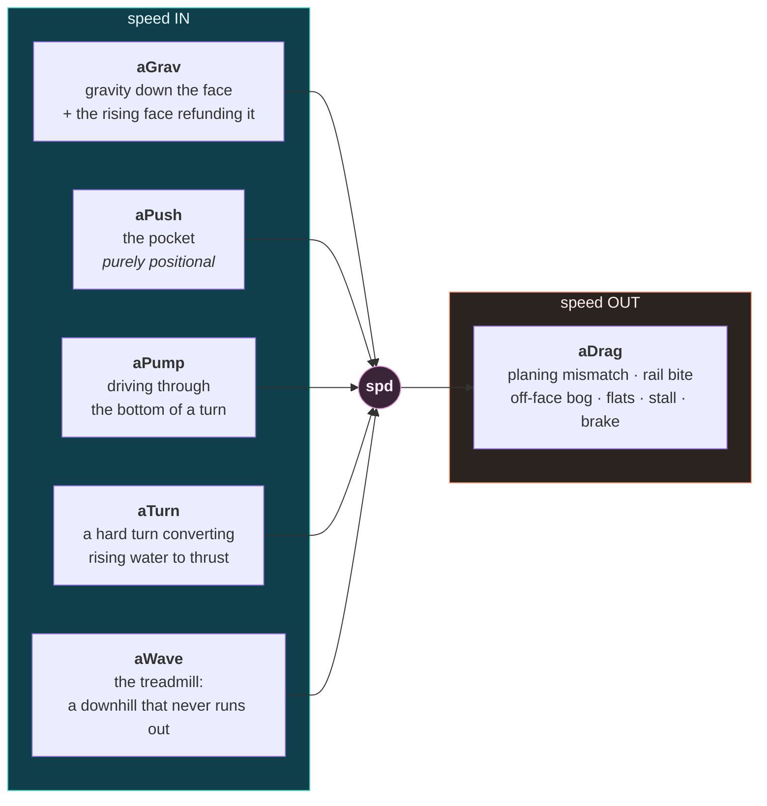

# Rider physics

`surfer.js`. The rider is **a free body in the world**, not a point pinned to the wave. Every
substep it reads whatever water surface is under its world position — the steep pocket, the soft
shoulder, the flat inside, or the back of the wave once you run over the top — and the wave
drifts and peels underneath it.

- [State](#state)
- [The two speeds](#the-two-speeds)
- [The force budget](#the-force-budget)
- [Position, and the four things that move you](#position-and-the-four-things-that-move-you)
- [Trim: the planing model](#trim-the-planing-model)
- [Steering](#steering)
- [The three manoeuvres](#the-three-manoeuvres)
- [Scoring](#scoring)
- [Known simplifications](#known-simplifications)

---

## State

```js
x, z      world position on the ocean, metres
spd       speed in the wave frame, m/s
psi       heading, measured against the local wave frame
w         stance: −1 back over the fins, +1 forward toward the nose
b         the break point, which peels along the crest independently
```

`psi = 0` is along the line toward the shoulder; positive turns **up** toward the lip, negative
drops **down** the face toward the trough. It is a true wrapping angle, so a cutback must pass
180° to come back down the face — geometrically correct, and the absence of that wrap was the bug
that made cutbacks impossible in an earlier revision.

Stance is **walked, not sprung**. Holding a key moves you along the deck at `stanceRate` and you
*stay* there; releasing does not recentre you, because trimming a board is a position, not a lean.

### The run never ends

`get alive()` returns `true`, unconditionally. You cannot wipe out, get kicked off, drown, or ride
it to the sand — the run ends when you restart it. This is deliberate: the whole skill is keeping
the board in the pocket while the pocket moves through the world, and a fail state turned that
into a series of short punishments rather than a thing to practise. `STATE` and the wipeout
branches survive so older callers still resolve.

---

## The two speeds

This distinction runs through everything and is worth getting straight first.

```
    spd     ── velocity in the WAVE FRAME. What moves you around on the face.
                Pocket-position bookkeeping runs off this.

    carry   ── the ground-track of holding station on a moving wave.
                carry = 0.55 · (c / sin α) · (0.35 + 0.65·stand) · onFace · carryCut

    vWater  ── hypot(spd, carry). Speed THROUGH THE WATER.
                All hydrodynamics — fin grip, planing, turn radius, drag ceilings —
                run off this. It's also the number on the HUD.
```

`carry` exists because a planing board on a moving face gets translated along *with* the wave.
It is what lets you **stall in a barrel**: hold station on the curl (`closing ≈ 0`) while still
carrying 33–39 km/h through the water, so the board remains turnable. The shoulder is genuinely
dead by comparison (8–11 km/h) because `carry` scales with `stand`.

`carryCut` is the escape hatch. A held brake cancels up to 85% of `carry`, because **bogging the
tail is precisely the act of not planing any more** — once you are sitting in the water the wave
passes under you and goes on without you. Without this term the HUD had an unbeatable ~18 km/h
floor: you could stand on the brake and watch the number refuse to fall, because stopping the
board does nothing to `carry`.

---

## The force budget

Six terms, summed into a single longitudinal acceleration. All in m/s².



| term | expression | what it models |
|---|---|---|
| `aGrav` | `(g·G_tune·slopeSeaward + lift)·sin ψ` | the drop gains, the climb costs — and `lift` refunds part of the climb because the face is **rising water**, not static terrain |
| `aPush` | `push · pw · faceBand · shapePow` | the pocket. **Purely positional** — no key adds thrust |
| `aPump` | `pumpGain · drive · max(0,−sin ψ) · pw · faceBand` | weight forward while pointing down the face |
| `aTurn` | `min(cap, turnDrive · btGain · ω² · upFlow · flow) · bite · (1 − vw/18)` | banking against the up-flow at ~90° converts it to thrust |
| `aWave` | `max(0, vGlide − spd) · waveGrab` | the moving hill. One-way: it pulls you up to a cruising speed, never brakes you |
| `aDrag` | see below | everything that takes it back |

### `aWave` — the infinite downhill

The wave advances shoreward under you at its celerity, so the face is a downhill that never runs
out. Rather than a one-off drop impulse, this carries `spd` up toward a cruising speed set by how
fast the wave itself is moving:

```js
faceSteep = clamp01((φ − 0.35) / 1.15)          // fat ~0.4, hollow ~1.6+
height    = clamp01((u + 0.08) / 0.6)           // ~0 at the trough, 1 up high
onWall    = (0.15 + 0.85·height) · stand
vGlide    = waveGlide · c · (0.2 + 0.8·faceSteep) · onWall
```

Two design decisions are encoded here. **The steeper the face, the faster the downhill it
presents** — so you lose speed on the fat bits and have to point down and keep the board planing
to hold what you have. And **the up-flow is strongest high on the face and dies in the trough**,
so the fast line is high and the trough is the slow zone. That is what makes the roller-coaster
line pay: drop for speed off gravity, then carry it high.

### `aDrag` — the losses

```js
aDrag  = −plane · (glide·spd + dragQuad·vw·spd)     // planing drag, scaled by trim mismatch
       − railDrag · railBite · ω · spd               // what a carve costs
if (onFace < 0.5)  aDrag −= dragLin · 3.0 · spd     // no wall to plane on — you bog
if (u < −0.2)      aDrag −= dragLin · 2.5 · spd     // gliding the flat inside
if (stallT > 0)    aDrag −= dragLin · 2.5 · spd     // bogged after a blown snap
if (braking)       aDrag −= dragLin · 9.5 · lev · spd  +  7.0 · lev
if (pumpT > 0)     aDrag *= 1 − 0.55·(pumpT/show)   // a pump unweights the board
```

The pump's `slip` term is applied **last**, as a scale on the whole accumulated drag, because
the point is to relieve every source of it at once. That is what "unweighting the board" means,
and it is what makes a pump's speed *persist* long enough to be worth linking off. Without it a
pump lifted you above the drag equilibrium and the next few frames pulled you straight back down
— speed gained and instantly lost.

The brake needs two terms because they do different jobs: the proportional one dumps speed hard
while you still have some, and the **constant** one (`holdStop`, not scaled by `spd`) carries you
the rest of the way to an actual stop. Proportional drag alone decays toward zero without ever
reaching it — you would coast forever at a crawl.

---

## Position, and the four things that move you

`spd` along your heading is only one of them.

```mermaid
flowchart TD
    H["<b>1 · your own heading</b><br/>x += hx·spd·dt<br/><i>where the board is pointed</i>"]
    C["<b>2 · the wave's carry</b><br/>x += driftSpeed·dt·<b>onFace</b><br/><i>this is what catching a wave IS</i>"]
    WC["<b>3 · wall catch</b><br/>if u &lt; 0.30, an UPWARD-only push<br/><i>a small face can't dump you off the base</i>"]
    RG["<b>4 · rail grip &#40;Coanda&#41;</b><br/>a rail set at speed draws you UP the face<br/><i>needs speed; eases off near the lip</i>"]

    H --> POS(("world<br/>x, z"))
    C --> POS
    WC --> POS
    RG --> POS

    style C fill:#0e3f4a,stroke:#4ad0c0,color:#eaf8ff
    style POS fill:#3a2438,stroke:#d98fd0,color:#ffeaff
```



**Term 2 is the important one.** `onFace` gates it, and that gate is what makes losing a wave
real: run over the back and the wave lets go of you, rolls on without you, and no amount of
paddling brings it back.

**Term 3** is upward-only by design. An earlier version pushed both ways, which read as a skid.
Now it only stops a small face from dumping you off the base — point the nose down hard and your
own motion still beats it, so you can dive off the bottom and head for the beach when you mean to.

**Term 4** is the *rail*, not the fins. A rail set at speed grips the face and draws the board up
into the wave, which is how you hold a high line instead of sliding off it. It needs speed — like
nose-riding, it fails when slow — and it eases off approaching `gripLine = 0.72` (or the apex, if
the section barrels below it), so it holds you on a high line rather than throwing you over the
lip. To go higher you have to actually aim the nose up.

There is deliberately **no along-line sweep term**. `aWave` gives you real speed down the line, so
you keep pace with the peel under your own steam: outrun it onto the shoulder and the face
flattens and slows you until the curl catches up; fall behind and you bog in the foam. That
balance settles you into the pocket on its own.

---

## Trim: the planing model

From the momentum planing model in [Surfing.pdf](references/Surfing.pdf) (eq. 20–28):

```
    lift        Fy ~ ρ L W V² sin²(a) cos(a)
    drag        Fx ~ ρ L W V² sin³(a)
    efficiency  Fy/Fx = cot(a)
```

So **flatter is always more efficient** — but you still need enough angle to carry your weight,
and the angle you need falls as `V²`. The best trim is therefore the *smallest angle that still
planes*, and it walks forward as you speed up.

```js
alpha    = TUNE.trim − trimStance · w              // the angle you're actually at
alphaReq = √(liftNeed / (max(6, vw²) · lenR))      // the angle you need, falling with speed²
trimErr  = alpha − alphaReq
plane    = planeBase + trimOver·over + trimUnder·under·(1 + 4·under)
```

Drag is the **mismatch**, penalised in both directions and asymmetrically:

```
    too much angle  →  you're dragging the tail through the water    (graceful)
    too little      →  the nose loads up and starts to bury          (catastrophic)
```

Measured settled speed by stance: peaks at centre (46 km/h), tail is graceful (~30), nose is a
disaster (7 — it buries). The optimum walks forward with speed, from −0.75 at 5 m/s to +0.25 at
14 m/s. The HUD's `trimmark` shows where it currently sits, so you can chase it.

`trimTurnRelief` recognises that tail-down mid-turn is **fin load, not brake** — it relieves 65%
of the over-trim penalty while you are actually turning.

Being too flat is not "more glide". It is the nose starting to bury.

---

## Steering

```js
carve = turnBase · (1 − turnDriveDamp·drive) · grip · (0.20 + 0.80·flow) / lenR
pivot = turnPivot · tailPush · (0.35 + 0.65·flow) · finLever / √lenR
dpsi  = steer · (carve + pivot)  −  gravTurn·sin β·cos ψ·(spd/6)     // gravity drops the nose
turnRate = approach(turnRate, dpsi, 12, dt)                          // ~83 ms lag
psi      = wrapPi(psi + turnRate·dt)
```

Two mechanisms with different characters:

- **`carve`** is the rail. Grip-limited, so it *falls off* with speed (`grip = 1/(1 + vw/22)`);
  inversely proportional to board length; and damped by weight-forward, which puts you on the rail
  and draws the arc out long.
- **`pivot`** is the fins at the tail, driven by the <kbd>Space</kbd> tail stamp. Speed-independent,
  and gated by stance leverage — **you cannot stamp a tail you are not standing near**.

Board geometry is live: `boardLen` scales both (a longer board carves wider and pivots less),
and `finPos` moves the fins between forward-and-loose and tail-and-drivey, feeding `finLever`
(pivot authority) and `finBite` (how much drive a turn generates).

---

## The three manoeuvres

All three are **double-tap gestures**, and all three are graded on *where you are*, never on how
long you held anything.

```mermaid
flowchart TD
    subgraph SNAP["SPACE ×2 — THE SNAP"]
        direction TB
        S1["graded from position:<br/>vert · height · attack · speed"]
        S2["q → degrees &#40;25–215&#41;<br/>q → duration &#40;0.18–0.40 s&#41;"]
        S3["drives psi <b>directly</b>,<br/>bypassing the whole lag chain"]
        S1 --> S2 --> S3
    end
    subgraph PUMP["↑↑ — THE PUMP"]
        direction TB
        P1["needs rising water:<br/>q = pw · steep · stand"]
        P2["<b>links</b> if inside 0.62 s<br/>chain → ×2.30 max"]
        P3["+speed, +up the face,<br/>+forward hop, −drag"]
        P1 --> P2 --> P3
    end
    subgraph BRAKE["↓↓ hold — THE BRAKE"]
        direction TB
        B1["strength = leverage over the tail<br/><i>from your stance, only</i>"]
        B2["gentle initial set,<br/>sustained drag while held"]
        B3["also cancels 85%<br/>of the wave's carry"]
        B1 --> B2 --> B3
    end

    style SNAP fill:#3a2438,stroke:#d98fd0,color:#ffeaff
    style PUMP fill:#0e3f4a,stroke:#4ad0c0,color:#eaf8ff
    style BRAKE fill:#2a2320,stroke:#ff9b7a,color:#ffeee6
```



### The snap

Everything else in the rig is a lag: `tailPush` is an 83 ms filter feeding `pivot`, feeding
`dpsi`, which is itself an 83 ms filter into `turnRate`. Two cascaded poles is ~0.4 s to full
rate, which is why nothing in the ordinary path could ever be explosive. **The snap deliberately
bypasses that chain and drives `psi` directly**, with `turnRate` *assigned* rather than
approached — which also means lean, camera roll, spray and the audio hiss bed all read the snap
for free without any of them knowing it exists.

Grading:

```js
height = clamp01(u / max(0.20, apex))              // normalised against the reachable maximum
vert   = clamp01((φ − 0.70) / 1.90)                // how vertical the face is under you
attack = clamp01(sin(max(0, psi)))^1.60            // driving UP the face
fast   = clamp01(spd / TUNE.snapSpeed)

setup  = (0.42·vert + 0.18·height) · (0.45 + 0.55·attack)  +  0.40·attack
q      = clamp01(setup^1.55 · 0.76  +  fast · 0.24)
```

The three face terms are **summed, not multiplied**: a product would let any single zero (flat
section, nose pointing the wrong way) annihilate the whole thing, and then speed could never
rescue a bad setup the way it should. Speed enters as a separate 24% share, so a fast rider can
force a workable snap out of a section that has not stood up — but can never buy a perfect one.

`attack` enters **twice**, as its own share and as a partial multiplier on the section terms.
With a purely additive split, being high on a vertical wall while pointed straight *down* the face
still graded 163°. It should not: that is a drop, not a snap.

`height` must be normalised against `colApexU()` rather than against a fixed threshold. The apex
is only 0.64 right at the curl and opens to 1.0 out on the fat shoulder — grading raw `u` would
make a perfect pocket snap literally unscoreable.

Outcome: `q` maps to rotation (`snapMin`→`snapMax`, over 180° reads as a `REVERSE`) and duration.
A clean snap **projects** you slightly (`keepBest = 1.02`); a blown one (`q < 0.22`) dumps your
speed and leaves you bogged in `stallT`. A weak snap out where there is no pocket is not called
blown — it is a `SPEED CHECK`, the standard way to scrub off a few knots and let a section come
to you.

One subtlety: `aTurn` and rail drag both read `ω`, and they were written for a carve topping out
near 4 rad/s. A snap's 10–16 rad/s would saturate `turnDriveMax` outright — a **blown** snap would
collect exactly as much drive as a perfect one — and rail drag would scrub speed by how fast you
spun rather than by how well you did it. So `ω` is capped at `omCap = 1.6` while a snap runs, and
the snap pays and punishes through `_fireSnap` instead, on quality.

### The pump

A decompression: spring forward off the front foot, unstick the rail, drive off the rising water,
settle back onto the face. A power trim.

**Linking is the point.** Land the next one inside `linkWin = 0.62 s` and the chain multiplier
climbs by `linkStep = 0.34` up to `×2.30`; let the window lapse and it resets to 1. You cannot
bank a multiplier and cash it in three seconds later.

```js
q     = clamp01(pw · (0.35 + 0.65·steepq) · stand)      // is there rising water at all?
lev   = lerp(0.15, 1.00, …w…)                            // a pump springs off the FRONT foot
ceil  = lerp(9.5, 19.5, stand·(0.35 + 0.65·steepq))      // what this wave will support
room  = clamp01(1 − vWater / ceil)
spd  += (base + gain·q·lev) · pumpLink · room
```

`room` is what stops it being a free-energy pedal — the closer you are to the ceiling, the less
it returns. And **the ceiling belongs to the wave**: a steep stood-up pocket has speed in it, fat
water does not, however well you pump or however long the chain. Linking gets you to the wave's
limit *faster*; it cannot argue with the limit.

`base` and `gain` are split deliberately. The old single gain was multiplied by quality *and*
stance *and* room, so three individually-reasonable factors compounded into a pump worth roughly
1 km/h that drag ate immediately. `base` is the floor every landed pump is worth.

A pump also carries you up the face (where the speed came from) and throws the board **forward**
by `hop = 1.0 m` along the heading, because a pump is a jump. The speed bump alone read as the
numbers going up rather than as an athletic movement.

Stance **scales** the return rather than being moved by it. An earlier version threw your stance
forward for you, which meant the manoeuvre picked your trim — now you pick it and the pump pays
out accordingly.

### The brake

Strength is entirely your **leverage over the tail**, and the brake does not walk your stance to
get it:

```js
brakeLev = clamp01(0.08 + 0.92 · (0.00 − w))
```

Near zero at dead centre — standing over the middle of the board you are not bogging anything.
Not *exactly* zero, though: the brake must be able to bring you to a stop from any stance if you
hold it long enough. From the middle that takes a very long time, which is the honest answer.

To stop hard you have to **walk back first and commit**. That is the decision the mechanic is
about, and moving the stance for you would make it for you. The HUD reports what you actually
got: `HARD BRAKE`, `CHECK`, or `NO TAIL`.

The brake is also fully **independent of the walk**. It used to end the moment `weight ≥ 0`, which
meant holding the brake and walking backward were the same act — you could not brake from
mid-stance, and the hold dragged your stance to the tail whether you wanted it there or not. Now
the walk decides how much tail you have and the brake decides whether you are leaning on it.

---

## Scoring

Five accumulators plus distance, all multiplied by a combo that builds in the pocket and decays
out of it (`comboMax = 5.0`).

| source | rate | notes |
|---|---|---|
| `sPocket` | 11 /s × pocket power | just being in the right place |
| `sTrim` | 7 /s | a quiet fast line: `pw > 0.5`, low turn rate, `spd > 8`, `u > 0.18` |
| `sBarrel` | 62 /s | while `barreled` |
| `sTurns` | `42 × amplitude × speed × combo` | paid on **completed** direction changes |
| `sSpeed` | 0.55 × (spd/14) × pocket | rewards speed only where it counts |
| `dist` | 0.5 /m | |

Turns are scored in `_scoreTurns()` when the swing direction reverses, and labelled by amplitude,
sharpness and direction:

```
    swinging back up the face   →  CUTBACK      (peak |psi| > 1.62)
                                   OFF THE TOP  (sharp, amplitude > 1.2)
                                   CARVE
    driving forward             →  BOTTOM TURN  (sharp)
                                   DRIVE
```

"Sharpness" is the **peak** rate over the arc, not the rate right now — "now" is the substep the
rate crossed zero to trigger the branch, so it is near zero by construction. Measuring it live
made `OFF THE TOP` and `BOTTOM TURN` unreachable and every turn read as a `CARVE` or a `DRIVE`.

The snap pays through `_fireSnap` and suppresses `_scoreTurns` while rotating, or the arc it just
watched would be scored a second time as a phantom cutback on top of the snap's own award.

### It was exploit-tested

From the [audit](references/PHYSICS-REPORT.md): 6 seconds of full-lock spin with the tail stamp
in the pocket settles at 39 km/h — **below** the 45–47 km/h clean-trim equilibrium. Turn drive
saturates via `turnDriveMax` and the `(1 − vw/18)` ceiling. Spinning never beats riding well.

Naive policies (do nothing, mash up, hold brake, never brake) all died in 7–10 s in the version
that had a fail state; a competent trim-and-thread line rode 60–67 s and scored ~1.5× a
non-trimming line. Skill pays monotonically, with no inversion.

---

## Known simplifications

Documented rather than hidden. All are measured and deliberate; see the
[audit](references/PHYSICS-REPORT.md) §3–4 for the full treatment.

- **Energy is additive with caps, not conserved.** This is a game loop. It was exploit-tested
  rather than proven.
- **`vWater` is direction-blind.** `hypot(spd, carry)` treats board velocity and water flux as
  always orthogonal, so climbing and dropping at the same `spd` give identical `vWater`. The
  `lift` term captures the energetic half, so gameplay reads right, but fin grip and planing get
  the wrong `v` at the extremes.
- **No cross-face advection.** Nothing moves `u` except your own heading. "The wave passes under
  you" is implemented along the line (foam catches you via `d`), never across the section. Would
  become visible if `gravTurn` were ever set to 0 — a parked board would then hover indefinitely.
- **Whitewater, foam ball and lip throw are kinematic**, not fluid — impulses and overrides.
- **Rail-grip loss at low speed replaces a balance model.** There is no falling-over simulation;
  the board simply stops holding its line.
- **`peelAt` slams to a hard-coded 24 m/s** past the end of the point rather than deriving the
  closeout from the beach bathymetry. Invisible in play, but inconsistent with the
  everything-derived philosophy.
