# The wave model

The wave is **derived from a seabed**, every frame, using textbook coastal engineering. There
is no list of sections, no scripted barrel, and no authored difficulty curve anywhere in the
project. There is a bottom, and everything else is a consequence of it.

- [The derivation chain](#the-derivation-chain)
- [Layer 1 — the seabed](#layer-1--the-seabed)
- [Layer 2 — the wave](#layer-2--the-wave)
- [The cross-section profile](#the-cross-section-profile)
- [How a barrel happens](#how-a-barrel-happens)
- [Local shape: the pocket gradient](#local-shape-the-pocket-gradient)
- [Pocket power](#pocket-power)
- [The world field](#the-world-field)
- [Sections are read, not written](#sections-are-read-not-written)
- [What the sliders actually do](#what-the-sliders-actually-do)

---

## The derivation chain

```mermaid
flowchart TD
    subgraph IN["INPUTS — the only authored numbers"]
        DEP["<b>depth</b><br/>metres over the reef"]
        SLO["<b>slope</b><br/>seabed gradient"]
        CON["<b>contour</b><br/>bearing of the depth contours"]
        PER["<b>period</b><br/>swell period, seconds"]
        SWL["<b>swell angle</b><br/>deep-water approach"]
    end

    C["<b>c = √&#40;g·d&#41;</b><br/>shallow-water celerity"]
    H["<b>H = 0.78·d</b><br/>depth-saturated breaker height"]
    L0["<b>L₀ = gT²/2π</b><br/>deep-water wavelength"]
    C0["<b>c₀ = gT/2π</b><br/>deep-water celerity"]
    XI["<b>ξ = slope / √&#40;H/L₀&#41;</b><br/>Iribarren / surf-similarity"]
    PHI["<b>φ = lerp&#40;46°, 138°, ξ&#41;</b><br/>pocket steepness"]
    TH["<b>θ = asin&#40;sin θ₀ · c/c₀&#41;</b><br/>Snell refraction"]
    PA["<b>α = θ + contour</b><br/>THE PEEL ANGLE"]
    PEEL["<b>peel = c / tan α</b><br/>how fast the curl runs"]
    ENDS["<b>endS = length · mean&#40;1/tan α&#41;</b><br/>how long the point is"]
    DUR["<b>T = length / c̄</b><br/>how long the ride lasts"]

    DEP --> C
    DEP --> H
    PER --> L0
    PER --> C0
    SLO --> XI
    H --> XI
    L0 --> XI
    XI --> PHI
    SWL --> TH
    C --> TH
    C0 --> TH
    TH --> PA
    CON --> PA
    PA --> PEEL
    C --> PEEL
    PA --> ENDS
    C --> DUR

    style IN fill:#0a1a22,stroke:#2a4a5a,color:#9fd0ff
    style PHI fill:#3a2438,stroke:#d98fd0,color:#ffeaff
    style PA fill:#3a2438,stroke:#d98fd0,color:#ffeaff
    style PEEL fill:#0e3f4a,stroke:#4ad0c0,color:#eaf8ff
```



The two highlighted boxes are the ones that decide whether a wave is worth riding: `φ` is *how
hollow* it is, and `α` is *how fast the curl runs away from you*. Everything a surfer cares
about reduces to those two, and both come from the bottom.

### The coupling that makes it honest

`H = 0.78·d` and `c = √(g·d)` share an input. That is not a shortcut — it is real physics, and
it is adopted deliberately:

> **You cannot ask for a big slow wave.** A bigger wave breaks in deeper water and therefore
> travels faster. Slow is bought with **peel angle**, not by slowing the ocean down.

This single constraint is what stops the tuner from producing incoherent waves. `DEPTH` moves
size and speed together, and the `POINT` / `ANGLE` / `PEEL TRIM` sliders are where a long,
workable, slow wall actually comes from.

---

## Layer 1 — the seabed

`bathymetry.js`. A point break is a headland with a submerged spur running off it. Three
properties of the bottom are sampled per station:

| output | what it decides |
|---|---|
| `depth` | wave **size** (`H = 0.78 d`) *and* **speed** (`c = √(g d)`) — coupled by design |
| `slope` | breaker **type** via Iribarren: gentle spills and crumbles, steep throws a lip |
| `contour` | the bearing the depth contours run, which sets **refraction** and the peel angle |

The baseline is `depth · (1 − 0.30·t)` — the inside gets progressively shallower as the wave
runs up the point — plus six **features** laid along the span as smooth Gaussian bumps, so the
bottom is continuous and so is everything derived from it:

```
    kind        depth      slope×     contour     what you ride
    ─────────────────────────────────────────────────────────────────────────
    ledge       −0.60 m    ×2.95      −6°         shallow reef step → THROWS
    bowl        −0.40 m    ×1.45      −11°        shallow, contour swings in
    flat        +0.55 m    ×0.45      +9°         deep gentle patch → CRUMBLES
    spur        −0.20 m    ×1.05      −16°        ridge; contour turns hard
    channel     +0.75 m    ×0.60      +5°         deep → the wave backs off
```

`ledge`, `flat` and `bowl` are guaranteed present — those three are what make a ride
interesting — then the remaining three are drawn from the pool and the whole order is shuffled
by the seeded RNG. So every seed is a different reef, but no seed is a boring one.

### Why the contour term dominates

Full Snell refraction pulls a crest to within ~8° of parallel with the contours, which is
exactly why **a straight beach closes out**. A headland's contours keep *turning* as the wave
wraps around it, so the crest can never catch up — and **the angle it fails to close is the peel
angle**. That is the whole mechanism of a point break, and it is why `contour` is added to `θ`
rather than correcting it.

---

## Layer 2 — the wave

`wave.js`. `Wave.raw(s)` reads the bottom and applies the chain above. Nothing in it is a
chosen number.

Two things are **derived at construction** rather than configured:

```js
duration = length / c̄                    // the wave dies when it reaches the sand
endS     = length · mean(1 / tan α)       // ...having peeled this far along the crest
```

`length` (the `RUN` slider, metres from first break to the sand) is authored; how long the point
has to be to support that run is not. A first pass samples the bottom on a normalised span to
get mean geometry, computes `endS`, then hands that span back to the bathymetry so features land
in the right places.

### The crest line

`_buildBaseline()` integrates a **bearing** into a polyline of ~200 samples, cached as
`(X, Z, cos, sin)` and read by `frame(s)` with linear interpolation.

The bearing is *not* the peel angle. The peel angle is crest-relative-to-contour and it jumps
around with every reef feature; the crest itself is a long, taut, nearly straight line that only
bends as it wraps the point. Integrating a bearing means **any wobble accumulates into
position** — feeding the peel angle in here made the wave visibly snake. So the bend is a single
smooth monotonic term:

```js
bend = TUNE.wrap · P_BEND        // P_BEND = 0.04 — deliberately tiny
g    = bend · t^1.3
```

Measured over the default 296 m point: bearing sweeps 0 → 16° monotonically, with a maximum bow
of 10.8 m — a 3.6% sagitta. A long wall with a gentle wrap.

`frame(s)` returns the local crest frame — origin `(x, z)`, tangent `(tx, tz)`, seaward normal
`(nx, nz)` — with the shoreward drift already applied. It is the single conversion point between
wave coordinates and the world.

---

## The cross-section profile

`column(φ, A)` builds the face for one station by integrating a tangent angle from the trough
upward in 32 steps:

```
    β(u) = φ · u^E                    E = CFG.wave.profE = 1.35

    run += cos β · du                 ← seaward offset
    ht  += sin β · du                 ← height
```

then scales the arc so the lip lands exactly `A` metres above the trough, and shifts everything
so **`run = 0` is the lip**.

```
    E > 1 makes the face CONCAVE — flat through the trough, standing up hard near the lip,
    which is the shape a real wall has. E = 1 would give a circular arc.

    β = 0      flat water
    β = 45°    a ramp
    β = 90°    a vertical wall            ← colApexU() returns the u where this happens
    β > 90°    overhanging                ← everything above the apex is throwing
```

The API is a **module-scope scratch pattern**: call `column()` once for a station, then query
`colAt(u)`, `colBeta(u)`, `colApexU()`, `colTrough()` for as many rows as you like. Always
re-call `column()` before switching station. This avoids allocating a profile per station per
frame — `waveMesh.update()` calls it 112 times a frame, and `Wave.field()` once per physics
substep.

`uFromRun(run)` inverts the profile — given a seaward offset, which height on the face is that?
The `run` table only increases monotonically up to the apex, so the inversion runs against that
stretch and anything at or beyond it reads as the crest.

---

## How a barrel happens

There is no barrel code. There is no tube geometry, no special case, no separate mesh. A barrel
is what the profile integral **does** when `φ` exceeds 90°:

```
    φ = 60°  spilling                φ = 100°  plunging              φ = 170°  fully thrown
                                              ╱▔▔╲                       ╭────────╮
              ╱▔                            ╱╱                          ╱          ╲
            ╱╱                            ╱╱                          │   ← you    │
          ╱╱                             ││                            ╲     are    │
        ╱╱                               ││                             ╲   here   ╱
      ╱╱                                 ││                              ╲________╱
    ──                                 ──                              ──
    the face is a ramp                 the lip is past vertical          the surface has
    you climb it                       and starting to overhang          folded over itself
```

Because the surface is parametric — `(run(u), ht(u))` rather than `y = f(x, z)` — nothing
prevents `run` from turning back on itself. A heightfield could not represent this at all, which
is the reason for the whole approach.

`φ` reaches those values through two additive routes:

1. **The bottom.** `φ = lerp(46°, 138°, smoothstep(0.35, 1.9, ξ))` — a steep reef under a long
   swell gives a plunging breaker.
2. **The pocket.** `shape()` adds up to `pitchGain = 0.55` rad more, peaking `pitchAt = 2 m`
   ahead of the break point and scaled by `hollow`. The lip pitches hardest right at the curl.

Capped at `phiMax = 3.02` rad (~173°). You are "in the tube" when `φ > 1.75`, `hollow > 0.45`,
`0.18 < u < apex` and there is real pocket power — all read off the model, never flagged.

---

## Local shape: the pocket gradient

`Wave.raw()` gives the wave's *intrinsic* shape at a station. `Wave.shape(s, b, t)` applies
what the break point is doing to it — and this is where the ride's texture comes from.

```mermaid
flowchart LR
    RAW["raw&#40;s&#41;<br/><i>A, φ from the bottom</i>"] --> SH["<b>shoulder</b><br/>size × peel<br/>scales every distance below"]
    SH --> ST["<b>steep</b><br/>vertical only where<br/>it's throwing"]
    SH --> STD["<b>stand</b><br/>hasn't stood up yet<br/>out on the shoulder"]
    ST --> PI["<b>pitch</b><br/>the lip throws<br/>2 m ahead of the curl"]
    STD --> PI
    PI --> BR["<b>broken</b><br/>collapsed to whitewater<br/>behind the curl"]
    BR --> DIE["<b>die</b><br/>past the end<br/>of the point"]
    DIE --> OUT["A, φ, hollow,<br/>broken, stand, steep"]

    style RAW fill:#0a1a22,stroke:#2a4a5a,color:#9fd0ff
    style OUT fill:#0e3f4a,stroke:#4ad0c0,color:#eaf8ff
```



| term | formula | what it models |
|---|---|---|
| `shoulder` | `(A/2.2)^0.70 · (peel/6.0)^0.60`, clamped 0.55–2.20 | how much workable wall the wave carries |
| `steep` | `0.30 + 0.70·exp(−((d−2)/(26·shoulder))^1.25)` | a wave is only vertical where it's actually throwing |
| `stand` | `1 − smoothstep(14·sh, 95·sh, d)` | the swell hasn't stood up out on the shoulder |
| `pitch` | `exp(−((d−2)/6)²) · 0.55 · (0.35+0.65·hollow)` | the lip pitching hardest at the curl |
| `broken` | `clamp01(−(d+1)/9)` | the face collapsed into whitewater behind the curl |
| `die` | `1 − smoothstep(endS, endS+150, s)` | the wave running out of point |

`shoulder` is the one that makes different seabeds *play* differently. A big slow point gives a
long workable wall and time to draw turns; a small fast one compresses everything into the
pocket. Every distance in the table above is multiplied by it, so that character propagates
without any per-wave authoring.

`steep` is why the pocket is worth chasing. It is modelled directly as a gradient in `d` rather
than bolted on as a bonus — a few tens of metres down the line, the same swell genuinely is a
rolling ramp instead of a wall.

---

## Pocket power

One function, `pocketPower(d, shoulder)`, gates almost every propulsion term in `surfer.js`.

```
    1.0 ┤        ┌──────────┐
        │       ╱            ╲
        │      ╱              ╲
    0.5 ┤     ╱                ╲___
        │    ╱                     ╲____
        │   ╱                            ╲______
    0.0 ┼──┴──────────┬──────────┬──────────┬────────▶  d
       −6.5           0          6·sh      26·sh
        foam        THE CURL   pocket end   shoulder
```

- **Behind the curl** (`d < 0`): `fade · (0.7 + 0.3·fade)` where `fade = clamp01(1 + d/6.5)`.
- **In the pocket** (`0 ≤ d ≤ 6·shoulder`): exactly `1`.
- **Out on the shoulder**: `exp(−((d − peak)/(20·shoulder))^1.5)`.

That behind-the-curl expression is shaped rather than linear for a specific reason. It used to be
a plain fade that gave `pw(−0.001) = 0.700` against `pw(0) = 1.000` — **a 30% step in the main
propulsion term at a line you cross constantly when riding deep**, felt as an invisible lurch.
The current form lands exactly on 1.0 at the curl and is C0-continuous. There is still a slope
kink at `d = 0`, which is imperceptible next to what it replaced.

---

## The world field

`Wave.field(x, z, t, b, sGuess)` is the bridge that lets the surfer be **a free body in the
world** rather than a point pinned to the wave. Given a world position, it answers: what water
is under me?

```mermaid
flowchart TD
    IN["world point &#40;x, z&#41;"] --> PROJ["4 Newton steps:<br/>project onto the drifting crest line<br/><i>s += &#40;x−fx&#41;·tx + &#40;z−fz&#41;·tz</i>"]
    PROJ --> S["station <b>s</b>, and<br/>seaward offset <b>run</b>"]
    S --> SHAPE["shape&#40;s, b, t&#41; → column&#40;φ, A&#41;"]
    SHAPE --> Q{"run &gt; crest run?"}
    Q -->|yes| BACK["<b>the back of the wave</b><br/>y falls to open sea<br/>slope pulls you further seaward<br/><i>onFace = 0</i>"]
    Q -->|no| FACE["<b>the rideable face</b><br/>u = uFromRun&#40;run&#41;<br/>β = colBeta&#40;u&#41;<br/><i>onFace = 1</i>"]
    BACK --> OUT["s, u, run, β, y, slopeSeaward,<br/>onFace, d, pocket, A, φ,<br/>steep, stand, hollow, broken, c, peel"]
    FACE --> OUT

    style FACE fill:#0e3f4a,stroke:#4ad0c0,color:#eaf8ff
    style BACK fill:#2a2320,stroke:#ff9b7a,color:#ffeee6
```



The projection converges in a couple of iterations because the crest is nearly straight and
`sGuess` is seeded with last frame's station. Four steps is comfortable margin.

The `onFace` flag is what makes losing a wave real. Go over the crest and:

- gravity now pulls you **further seaward**, so you roll off the back;
- `pocket` power goes to zero — no propulsion;
- drag triples — there is no wall to plane on;
- and critically, `surfer.step()` stops adding the wave's shoreward carry, so **the wave rolls
  on without you**.

---

## Sections are read, not written

`classify(ξ, peel, H)` reads a human label back off the derived numbers:

```js
peel > 11              → CLOSE OUT      // peeling faster than any board can travel
ξ > 1.55 && peel > 3.2 → BARREL         // steep bottom, makeable peel
peel > 6.5             → FAST SECTION
ξ < 0.55               → FAT SECTION    // gentle bottom, spilling
ξ > 1.2                → BOWL
otherwise              → OPEN WALL
```

So the `BARREL` callout on the HUD is not a flag set by a level designer — a shallow steep ledge
simply *is* a barrel section. `nextSection(s)` scans forward in 8 m steps and reports the first
station whose label differs from where you are, which is how the HUD can warn you what's coming
95 m down the line.

Verified in the [audit](references/PHYSICS-REPORT.md): steepening the bottom from 1:18 to 1:9
converts fat sections into barrels with no other change to any input.

---

## What the sliders actually do

<kbd>Tab</kbd> opens the panel. The seabed and swell rows are the interesting ones because they
propagate through the entire chain.

| slider | drives | you'll notice |
|---|---|---|
| `DEPTH` | `H = 0.78d` **and** `c = √(gd)` | bigger *and* faster together — they cannot separate |
| `SLOPE` | `ξ` → `φ` | 1:18 crumbles, 1:9 barrels. The hollowness slider. |
| `POINT` (wrap) | contour turn → peel angle | how hard the point wraps; what stops it closing out |
| `PERIOD` | `L₀` and `c₀` → `ξ` **and** refraction | long swell both hollows the pocket and refracts harder |
| `ANGLE` | deep-water approach → `θ` | wider = longer, slower peel |
| `PEEL TRIM` | divides the peel angle | trim on the result without touching the bottom |
| `PEEL SPEED` | scales `peelAt()` | at 0 the whole wall stands up at once — a closeout, and any heading becomes fair game |
| `RUN` | `length` | metres from first break to the sand; sets `endS` and the ride duration |

`POINT` is clamped to 0.80–1.15 rad (46°–66°) and that clamp was **measured, not guessed**. Below
46° the fast sections peel over 11 m/s, which no board can make; above 66° the slow sections drop
under 1.4 m/s and the curl crawls. Both ends are physically correct — they are just not waves you
can surf. The full scan is in [the audit](references/PHYSICS-REPORT.md#35-point-slider-extremes-produce-degenerate-waves--fixed),
along with a warning worth repeating: the first proposed clamp was computed against the *old*
refraction model and would still have exposed 17.6 m/s peel. Re-measure any range derived before
an upstream fix.

> **Note on the audit.** `docs/references/PHYSICS-REPORT.md` is a point-in-time measurement
> document, not a live spec. Where it disagrees with the source — it quotes `P_BEND` at 30%, for
> instance, against the current 4% — the code is authoritative.
